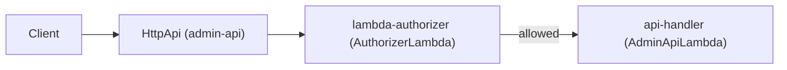
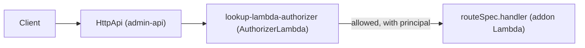

# Architecture

This page describes how the constructs in `packages/mailbox` and `packages/mailbox-cognito` are put
together and how a request travels through what they deploy. For the rules to follow when changing
them, see [CONTRIBUTING.md](../CONTRIBUTING.md).

## Construct tree

The consumer adds one `Mailbox` to its stack. `Mailbox` builds eight sections, in the order
`data`, `email`, `auth`, `edge`, `apis`, `ui`, `search`, `ops`, plus a `resource-group`. The
diagram shows each section and its main children, labelled with their construct ids.

```mermaid
flowchart TD
  mailbox["Mailbox"]
  mailbox --> data["data (DataSection)"]
  mailbox --> email["email (EmailSection)"]
  mailbox --> auth["auth (AuthSection)"]
  mailbox --> edge["edge (EdgeSection)"]
  mailbox --> apis["apis (ApisSection)"]
  mailbox --> ui["ui (UiSection)"]
  mailbox --> search["search (SearchSection)"]
  mailbox --> ops["ops (OpsSection)"]

  data --> datadeployer["data-deployer"]
  data --> auditwriting["audit-writing"]

  email --> sesevent["ses-event-processing"]
  email --> emailsending["email-sending"]
  email --> sesrules["ses-rules"]
  email --> emailprocessor["email-processor-lambda"]

  auth --> authkeystore["auth-key-store"]
  auth --> identityprov["identity-provisioner"]
  auth --> bootstrap["bootstrap"]

  edge --> stackdeployer["stack-deployer"]
  edge --> blobcdn["blob-cdn"]
  edge --> dns["dns"]

  apis --> jmapapi["jmap-api"]
  apis --> adminapi["admin-api"]
  apis --> websocketpush["websocket-push"]
  apis --> mcpapi["mcp-api"]

  ui --> adminui["admin-ui"]
  ui --> webmailui["webmail-ui"]

  search --> tantivy["tantivy-search"]

  ops --> licenserefresh["license-refresh"]
  ops --> stackfailure["stack-failure-detection"]
  ops --> sweeperinfra["sweeper-infra"]
  ops --> deferredremoval["deferred-removal"]
```

`OpsSection` is the only section that lives in `platform/`; the other seven live in `core/`. The
addons that `platform/update` and `platform/support` contribute are not children of a section of their
own: `ApisSection` creates them under `apis` through `IAdminApiAddonProvider.createAdminApiAddons`.

## Stacks

A mailbox deploys as one main stack plus the stacks that custom resources create from it.

- **Main stack.** The consumer's own stack, which contains the `Mailbox` construct. It holds the
  APIs, the Lambdas, the queues, the SES wiring and the CloudFront distribution of the blob CDN
  (`blob-cdn`).
- **Data stack.** `MailboxDataStack` holds the retained data: the DynamoDB tables and the blob
  store bucket. The `data-deployer` construct (`MailboxDataDeployer`) deploys it with a custom
  resource of type `Custom::MailboxDataDeployer`.
- **Edge stack in us-east-1.** `MailboxEdgeStack` holds the ACM certificate that CloudFront needs and
  the `jmap-blob-download` Lambda@Edge function, because both must live in us-east-1. The
  `stack-deployer` construct (`MailboxEdgeDeployer`) deploys it from a published template with a
  custom resource of type `Custom::MailboxEdgeDeployer`, and the main stack reads the certificate ARN
  and the published function version from the stack outputs. The `Cdn` in the main stack attaches
  that function version to the distribution.
- **Cognito data stack.** `MailboxCognitoDataStack`, from `mailbox-cognito`, holds the retained user
  pool, its domain, the resource server and the default groups. `MailboxCognitoDataDeployer` deploys
  it with a custom resource of type `Custom::MailboxCognitoDataDeployer`.

The deployer constructs are built on `DeployerInfra` from `mailbox-cdk-shared`. The stack classes
are the only place that declare CloudFormation parameters and outputs.

## Zones

`packages/mailbox/src` is split into zones, and the `zone-imports` lint rule enforces the matrix in
`packages/eslint-plugin-mailbox/src/zones/mailbox-zones.ts`.

- **`core`** is the mail server. It never imports `platform`.
- **`platform`** (`ops`, `support`, `update`) is everything around the mail server. It never imports
  `core` apart from the addon interfaces in `core/apis/addons.ts`.
- **`resources`** holds the single-resource classes. `core` imports them freely; `platform` imports
  only the Lambda wrappers and events listed as platform-only in `mailbox-zones.ts`, plus three
  contract files (`data-tables`, `audit-events-queue`, `identity-provisioner-lambda`).
- **`contracts`** holds the names and payload types that both zones read, and imports from neither.

`core` stands alone so that the mail server is complete without any `platform` feature. A `platform`
feature plugs in from the outside through an addon: the consumer passes an
`IAdminApiAddonProvider`, such as `StackUpdateAddonProvider`, in `MailboxProps.adminApiAddonProviders`,
and `core` only knows the interface.

## Request paths

### Admin API route

A request to the Admin API passes the API's Lambda authorizer before it reaches the handler. The
authorizer is the Go `AuthorizerLambda` wrapped in an `HttpLambdaAuthorizer`, and it applies the
`ADMIN_API` auth policy. The handler is the Go `AdminApiLambda`, behind the catch-all route
`/{proxy+}` (POST).

### Addon route

An addon declares one `routeSpec`. `AdminApi` mounts `${basePath}/{proxy+}` on the same HTTP API behind
a second authorizer, the `lookup-lambda-authorizer`, and forwards the request to the addon's
`handler`. It is the same `AuthorizerLambda` with the `ADMIN_API` auth policy and `PRINCIPAL_LOOKUP=on`,
and its result is cached for 60 seconds. It adds `principalId`, `principalName` and `displayName` to
the request context, and it blocks a request that has no principal. The Admin API's own `/{proxy+}`
route keeps the plain `lambda-authorizer`. The addon never sees the authorizer, so it cannot mount an
unprotected route.

## Artifacts

The Lambda code, the front-end bundles and the stack templates are not CDK assets. They are published
ahead of time into the artifact registry, and a synthesized template points at them directly, so
the stack needs no `cdk bootstrap`.

- `GoLambda` and `TypeScriptLambda` extend `ArtifactLambda`, which resolves the code from
  `lambdas/<lambdaId>.zip` through an `IArtifactResolver`.
- `Mailbox` uses the resolver passed in `MailboxProps.artifactResolver`. Without one,
  `MailboxArtifactResolverFactory.fromContext` builds a `PinnedArtifactResolver` from the versions the
  package ships in `artifact-versions.json`, which the CDK context keys `serverlessinbox:artifacts` and
  `serverlessinbox:artifact_versions` can override.
- A release is an immutable, versioned set of objects; a mutable channel such as `dev` serves
  development.
