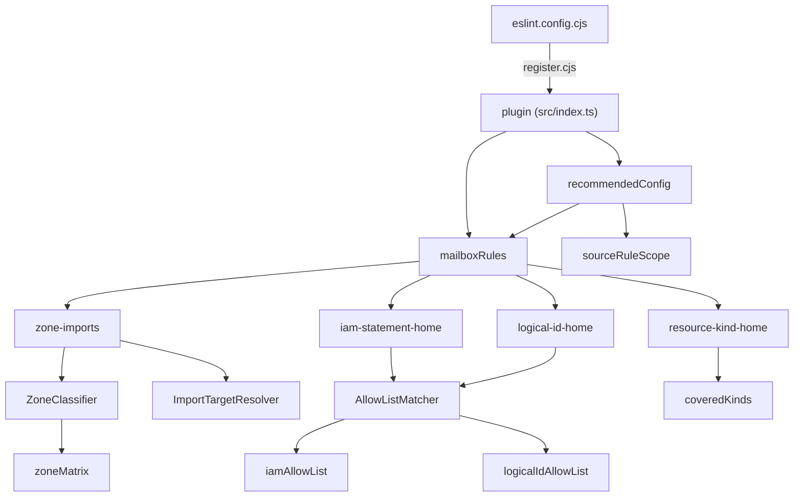

# @serverlessinbox/eslint-plugin-mailbox

Internal package; it is not published.

The ESLint plugin that enforces the structure of this repository: which folder a resource, an IAM
statement or a logical-id override may live in, and which zone of `mailbox` may import which. It also
carries the shared lint configuration that the repository's `eslint.config.cjs` uses.

## Concepts

- **Zones.** A file of `packages/mailbox/src` belongs to a zone by its path: `core`, `platform`,
  `platform-list`, `resources`, `contracts` or other. A matrix decides, per importing zone and target zone,
  whether an import is allowed, allowed only with `import type`, or forbidden.
- **Defined resources.** A resource class is created only in the `resources/` folder of its own kind:
  tables, queues, buckets, topics, events, workflows and lambdas.
- **Allow-lists.** A few files are permitted to hold IAM statements or `overrideLogicalId`. They are listed
  in the plugin, so a new exception is a reviewed change to this package.
- **Source scope.** The source rules govern `src/` of `mailbox`, `mailbox-cdk-shared` and
  `mailbox-cognito`. Code in the `runtime/` folder of those trees and in `__tests__/` folders is outside them.

| Rule | Enforces |
|---|---|
| `mailbox/zone-imports` | The zone matrix between `core`, `platform`, `platform-list`, `resources` and `contracts` |
| `mailbox/events-import` | Only `resources/lambdas` and `resources/events` import `resources/events`, and then with `import type` |
| `mailbox/kit-isolation` | `mailbox-cdk-shared` never imports the `mailbox` package |
| `mailbox/plan-labels` | No plan labels or change narration in comments |
| `mailbox/align` | `=` and `:` are aligned in groups of consecutive lines |
| `mailbox/iam-statement-home` | IAM statements only in `resources/`, `grants/` and the allow-list |
| `mailbox/logical-id-home` | `overrideLogicalId` only in a Stack class or on the allow-list |
| `mailbox/removal-home` | Resource-removal implementations only in `platform/ops/sweeper/` |
| `mailbox/resource-kind-home` | A covered resource class is created only in the `resources/` folder of its kind |

The first five rules apply to every TypeScript file. The last four apply to the source scope.

## Solution design



`recommendedConfig` returns a list of flat configs. Besides the plugin rules it sets the type-safety and
style rules, the restricted-syntax and synchronous-filesystem rules and the forbidden grant helpers, and
it turns off the rules that tests and the synth-time readers are exempt from.

| Folder | Holds |
|---|---|
| `src/rules/` | One file per rule |
| `src/zones/` | The zone classifier, the import target resolver, the zone matrix and the package roots |
| `src/model/` | The allow-lists, the covered resource kinds and the allow-list matcher |
| `src/configs/` | The pieces `recommendedConfig` is assembled from |
| `register.cjs` | Registers `ts-node`, so a CommonJS config can load the plugin from its TypeScript source |

## Usage

The repository's `eslint.config.cjs` loads the plugin from source and applies the recommended
configuration. `tsconfigRootDir` is the repository root; `extraConfigs` appends further flat configs.

```javascript
require('@serverlessinbox/eslint-plugin-mailbox/register');
const mailbox = require('@serverlessinbox/eslint-plugin-mailbox');

module.exports = [
  {
    ignores: ['lib/', 'dist/', '**/*.d.ts', '**/*.js', '.yarn/'],
  },
  ...mailbox.configs.recommended({ tsconfigRootDir: __dirname }),
];
```

## Reference

| Export | Purpose |
|---|---|
| `configs.recommended(options)` | The flat configs for the repository; options are `tsconfigRootDir` and `extraConfigs` |
| `rules` | The nine rules above, by name |
| `meta` | The plugin name and version |
| `@serverlessinbox/eslint-plugin-mailbox/register` | Registers `ts-node` so the plugin loads from TypeScript source |

## Building and testing

```sh
yarn test
```
