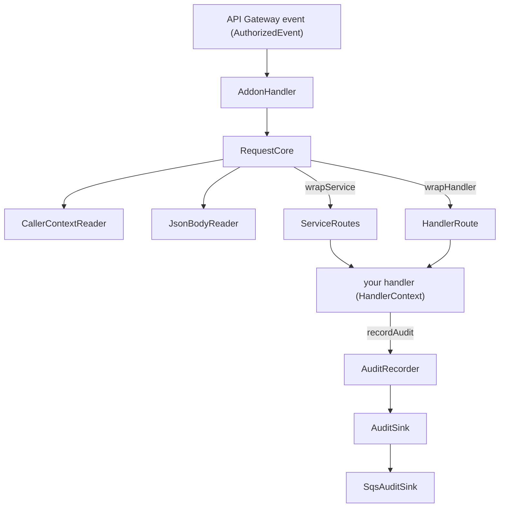

# @serverlessinbox/mailbox-addon-sdk

Internal package; it is not published.

The handler SDK for the Lambdas that serve the Admin API services of ServerlessInbox addons. It turns an
API Gateway request into a typed call: it reads who is calling, decodes the body, runs your handler,
records the audit event you ask for and answers with the right HTTP status.

## Concepts

- **The addon route.** An addon Lambda sits behind the lookup authorizer of the Admin API. The authorizer
  resolves the principal and passes it to the Lambda in the request context; the SDK reads it from there.
  A request without a tenant or a principal is answered 401 before your handler runs. The SDK performs no
  admin or group check: who may reach the Lambda is decided before it runs.
- **`wrapService`** serves an IDL-generated service. The last segment of the request path names the method,
  the body is decoded into the request message and the response message is encoded back, both with the
  generated protobuf schemas. The compiler rejects a handlers object that lacks a method of the service or
  types a request, a response or the context differently.
- **`wrapHandler`** serves a free-form endpoint that has no generated service. The body is validated with a
  [typanion](https://mael.dev/typanion/) schema before your function sees it.
- **`Caller`** is who the request comes from, as the authorizer resolved it: `tenantId`, `principalId`,
  `principalName`, `displayName` and `groups`. `displayName` is empty when the principal has none.
- **Audit.** Nothing is audited unless the handler asks. `HandlerContext.recordAudit` takes an
  `AuditEntry`: how the request ended, the entity it touched and what changed. The tenant, the actor
  (taken from the caller and the source address) and the action come from the request, so a handler cannot
  attribute a change to anyone else. The values of a field whose name suggests a secret (password, token,
  key and similar) are replaced by `[REDACTED]`. The event goes to an `AuditSink`; `SqsAuditSink` sends it
  to the audit events queue. A sink failure rejects the `recordAudit` call, and what that means for the
  request is the handler's to decide.
- **Errors.** A handler throws an error class from this package and the SDK answers with its status. The
  body of the answer is plain text.

| Error class | Status |
|---|---|
| `InvalidInputError` | 400 |
| `UnauthenticatedError` | 401 |
| `ForbiddenError` | 403 |
| `NotFoundError` | 404 |
| `AlreadyExistsError` | 409 |
| `ConflictError` | 409 |
| any other error | 500, with the body `internal server error`; the cause is logged and never answered |

## Solution design



`RequestCore` reads the caller before the body, so a request that is not authenticated learns nothing about
its body. Failures are logged through the `RequestLogger` you pass in; only a request that failed with a
server error flushes its buffered trace.

| Folder | Holds |
|---|---|
| `src/handler/` | `wrapService`, `wrapHandler`, the request core and the generated-service types |
| `src/caller/` | `Caller`, `HandlerContext`, the branded `TenantId` and `PrincipalId`, and the reader of the authorizer context |
| `src/audit/` | The audit entry and event, the recorder and the sinks |
| `src/errors/` | The error classes |
| `src/json/` | The JSON body reader and `JsonValue` |

## Usage

A Lambda for an IDL-generated service. `ExampleServiceRuntime` is the `<Service>ServiceRuntime` const that
the IDL code generation emits next to the message schemas. A handler answers with a message made from the
response schema. `LoggerBuffer` implements `RequestLogger`.

```typescript
import { create } from '@bufbuild/protobuf';
import { SQSClient } from '@aws-sdk/client-sqs';
import {
  NotFoundError,
  SqsAuditSink,
  wrapService,
  type ServiceHandlersOf,
} from '@serverlessinbox/mailbox-addon-sdk';
import { LoggerBuffer } from '@serverlessinbox/mailbox-cdk-shared/lambda-runtime';

import { GetGreetingResponseSchema } from './generated/example_pb';
import { ExampleServiceRuntime } from './generated/example_service';

const logger    = new LoggerBuffer('example-api', 'info');
const auditSink = new SqsAuditSink(new SQSClient({}), process.env.AUDIT_EVENTS_QUEUE_URL ?? '');

const handlers: ServiceHandlersOf<typeof ExampleServiceRuntime> = {
  getGreeting: async (context, request) => {
    if (request.name === 'nobody') {
      throw new NotFoundError('no such person');
    }

    await context.recordAudit({ status: 'success', entityId: request.name });

    return create(GetGreetingResponseSchema, { text: `Hello ${request.name}, from ${context.caller.principalName}` });
  },
};

export const handler = wrapService(ExampleServiceRuntime, handlers, auditSink, logger);
```

A free-form endpoint, validated with typanion:

```typescript
import { SQSClient } from '@aws-sdk/client-sqs';
import { SqsAuditSink, wrapHandler } from '@serverlessinbox/mailbox-addon-sdk';
import { LoggerBuffer } from '@serverlessinbox/mailbox-cdk-shared/lambda-runtime';
import * as t from 'typanion';

const logger    = new LoggerBuffer('example-api', 'info');
const auditSink = new SqsAuditSink(new SQSClient({}), process.env.AUDIT_EVENTS_QUEUE_URL ?? '');

const isRenameRequest = t.isObject({ id: t.isString(), name: t.isString() });

export const handler = wrapHandler(
  isRenameRequest,
  async (context, body) => {
    await context.recordAudit({
      status:   'success',
      entityId: body.id,
      changes:  [{ field: 'name', newValue: body.name }],
    });

    return { id: body.id, renamedBy: context.caller.principalId };
  },
  auditSink,
  logger,
);
```

## Reference

| Export | Purpose |
|---|---|
| `wrapService`, `ServiceHandlersOf`, `GeneratedService`, `GeneratedMethod` | Serve an IDL-generated service, and the types that check its handlers against the generated runtime |
| `wrapHandler`, `HandlerRun` | Serve a free-form endpoint with a validated body |
| `AddonHandler` | The Lambda handler both wrappers return |
| `RequestLogger`, `LogFields` | The buffered logger a handler writes the request trace to |
| `Caller`, `HandlerContext` | Who is calling, and what a handler receives besides the request |
| `CallerContextReader` | Reads a `Caller` from the authorizer context of an event |
| `TenantId`, `toTenantId`, `PrincipalId`, `toPrincipalId` | Branded identifiers; an empty value is rejected |
| `AuditEntry`, `AuditEvent`, `AuditSink`, `SqsAuditSink` | What a handler reports, what is recorded, where it goes and the SQS sink |
| `InvalidInputError`, `UnauthenticatedError`, `ForbiddenError`, `NotFoundError`, `AlreadyExistsError`, `ConflictError` | Errors that map to an HTTP status |
| `JsonValue` | Any value `JSON.parse` can return |

`SqsAuditSink` takes an `SQSClient` and the URL of the audit events queue, and sends each event as one JSON
message.

## Building and testing

```sh
yarn test
```
