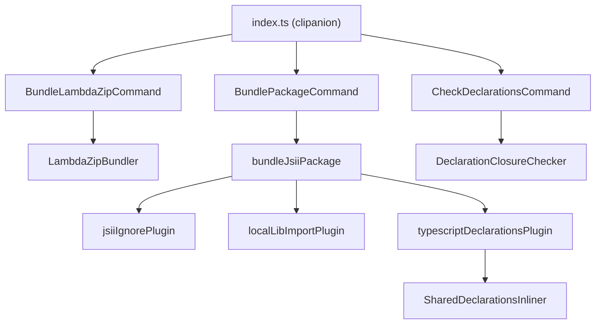

# @serverlessinbox/mailbox-bundler

Internal package; it is not published.

The build tool for the `mailbox-cdk` packages. It bundles the TypeScript Lambda handlers that the CDK
constructs deploy as zip files, it bundles a jsii construct package into its `lib/` folder, and it checks
that the declarations of a built package name only packages its consumers get installed. It runs as the
`mailbox-bundler` command, which each package calls from its Taskfile or its package scripts.

## Concepts

- **Lambda zip.** One entry file becomes one CommonJS `index.js` inside a zip. The same input always yields
  a byte-identical zip, so a rebuild changes the artifact only when the code changed.
- **jsii package bundle.** The sources of a construct package are bundled one output module per source
  file. Imports of jsii packages and relative imports stay external, so every construct keeps referring to
  the one shared copy of its types. The code of `@serverlessinbox/mailbox-cdk-shared` is inlined, and its
  declarations are copied into `lib/`, so the built declarations never import that package.
- **Declaration closure.** Starting at the declaration file named by `publishConfig.types`, every relative
  import is followed. A bare import in that closure must name a dependency, a peer dependency or a Node
  built-in.



## Requirements

- esbuild, a peer dependency, installed alongside this package.
- `package` needs `yarn` on the PATH and a `tsconfig.build.json` in the package folder.

## Commands

### `lambda-zip`

Bundles one TypeScript or JavaScript Lambda entry file into a CommonJS `index.js`, and writes that
single file into a zip.

| Flag | Required | Default | Meaning |
|---|---|---|---|
| `--entry <file>` | yes | none | Lambda entry file, relative to the current directory or absolute. |
| `--out <zip>` | yes | none | Zip to write. Missing folders are created, and an existing zip is replaced. |
| `--target <target>` | no | `node24` | esbuild target the bundle is compiled for. |
| `--minify` / `--no-minify` | no | on | Minify the bundle. |
| `--external <patterns>` | no | `@aws-sdk/*` | Comma-separated package patterns left out of the bundle. |

Example:

```sh
mailbox-bundler lambda-zip --entry src/handler.ts --out dist/lambdas/handler.zip
```

### `package`

Bundles a jsii construct package: `src/**/*.ts` into `lib/`, with jsii packages and the package's
own relative imports left external. Then it emits the `.d.ts` files with `tsc --emitDeclarationOnly`;
a non-zero exit fails the build. Finally it copies the declarations of `@serverlessinbox/mailbox-cdk-shared`
that the package's declarations reach into `lib/`, and rewrites the imports of that package to point at the copies.
Paths listed in the package's jsii `excludeTypescript` are skipped, and so are test folders (`__tests__`).

| Argument | Meaning |
|---|---|
| `package-folder` | Folder of the jsii package, relative to the current directory or absolute. |

Example:

```sh
mailbox-bundler package .
```

### `check-declarations`

Checks the declarations of a built package. It starts at the declaration file named by
`publishConfig.types` in the package's `package.json` and follows every relative import. Every bare import in
that closure must name a dependency or peer dependency of the package, or a Node built-in. It exits with
code 1, naming the declaration file and the specifier, when one does not. Declaration files outside the
closure that also name an undeclared package are counted separately.

| Argument | Meaning |
|---|---|
| `package-folder` | Folder of the built package, relative to the current directory or absolute. |

Example:

```sh
mailbox-bundler check-declarations .
```
