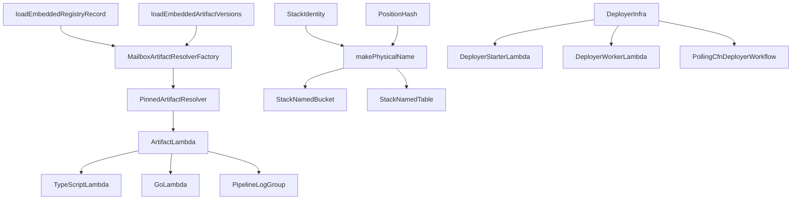

# @serverlessinbox/mailbox-cdk-shared

This package holds the internal building blocks of `@serverlessinbox/mailbox` and
`@serverlessinbox/mailbox-cognito`. It makes no compatibility promise.

The building blocks that the `mailbox` and `mailbox-cognito` construct libraries share: artifact
resolution, the Lambda wrappers that run published code, resource naming and tagging, the base table and
queue constructs, the sub-stack deployer scaffolding, and the runtime kit that the TypeScript Lambdas are
built on.

## Concepts

- **Artifact resolution.** The Lambda code, UI bundles and stack templates are published ahead of time, so
  a synthesized template points at them directly and the stack needs no `cdk bootstrap`.
  `MailboxArtifactResolverFactory` builds the resolver of a package from what that package ships: its
  registry record (the buckets artifacts are published to) and its artifact versions (the pinned version of
  every package it resolves). `serverlessinbox:` CDK context keys override both.
- **Lambda wrappers.** `TypeScriptLambda` and `GoLambda` are Lambda functions on ARM64 whose code is a
  published artifact, `lambdas/<lambdaId>.zip` of the package you name. Each logs to the shared log group of
  its pipeline, carries the artifact tags and sets `SERVICE_NAME`.
- **Physical names.** An explicit name ends in the position hash of the construct and the install id:
  `<stack name>-<label>-<position hash>-<install id>`. Moving a construct to another parent changes its
  name, so the old and the new resource never collide, and two installs in one account never share a name.
  `makePhysicalName`, `StackNamedBucket` and `StackNamedTable` produce such names.
- **Context.** Context only overrides the production default. An absent key means production behaviour; a
  present but invalid value throws, naming the key and the value. `isDevelopmentMode` and the helpers built
  on it make retained resources destroyable and buckets self-emptying in development.
- **Tagging.** The base tags correlate every resource of a deployment with its root stack, stack and
  product; the component tag groups resources by the part of the product they belong to.
- **Sub-stack deployers.** `DeployerInfra` is the scaffolding that deploys a sub-stack from a published
  template: a starter Lambda, a worker Lambda and a polling Step Functions workflow.
- **Runtime kit.** The code the TypeScript Lambdas run on lives behind the `lambda-runtime` subpath, apart
  from the construct code, because it needs the AWS SDK and CDK synthesis does not.

## Solution design



| Entry point | Holds |
|---|---|
| `@serverlessinbox/mailbox-cdk-shared` | The constructs, aspects and helpers used at synth time |
| `@serverlessinbox/mailbox-cdk-shared/lambda-runtime` | The runtime kit of the TypeScript Lambdas: logging, configuration, custom-resource handling and content operations |
| `@serverlessinbox/mailbox-cdk-shared/cdk-test-support` | Test-only helpers for reading a synthesized template |
| `@serverlessinbox/mailbox-cdk-shared/runtime-test-support` | Test-only fakes for Lambda runtime tests |

| Folder | Holds |
|---|---|
| `src/artifacts/` | The resolver factory, the loaders of the registry record and artifact versions, and the artifact tags |
| `src/context/` | The CDK context keys and the values read from them |
| `src/naming/` | Physical names, stack identity and stack name handling |
| `src/tagging/` | The base, component and sub-stack tags |
| `src/grants/` | The permission to read the status of the parent stack |
| `src/resources/` | Shared resources, one folder per kind: `lambdas`, `tables`, `queues`, `buckets`, `events`, `workflows`, `stacks`, `groups`, `artifacts` |
| `src/runtime/` | Code that runs inside the shared Lambdas, plus the handler kit |
| `src/cdk-test-support/`, `src/runtime-test-support/` | The sources of the two test-support entry points |

## Usage

A construct that deploys a TypeScript Lambda from the artifacts its own package ships. A package that
resolves artifacts, such as `mailbox`, keeps a `registry-record.json` and an `artifact-versions.json` at its
root:

```typescript
import * as path from 'node:path';
import {
  MailboxArtifactResolverFactory,
  TypeScriptLambda,
  loadEmbeddedArtifactVersions,
  loadEmbeddedRegistryRecord,
  makePhysicalName,
} from '@serverlessinbox/mailbox-cdk-shared';
import { Construct } from 'constructs';

export class ExampleFeature extends Construct {
  constructor(scope: Construct, id: string) {
    super(scope, id);

    const resolver = MailboxArtifactResolverFactory.fromContext(
      this,
      loadEmbeddedRegistryRecord(path.join(__dirname, '..', 'registry-record.json')),
      loadEmbeddedArtifactVersions(path.join(__dirname, '..', 'artifact-versions.json')),
    );

    new TypeScriptLambda(this, 'worker', {
      lambdaId:         'example-worker',
      packageName:      'example-package',
      artifactResolver: resolver,
      pipeline:         'admin',
      functionName:     makePhysicalName(this, 'worker', { maxLength: 64 }),
    });
  }
}
```

Gating a whole subtree on a CloudFormation condition:

```typescript
import { Aspects, CfnCondition, Fn, Stack, StackProps } from 'aws-cdk-lib';
import { GateOnConditionAspect } from '@serverlessinbox/mailbox-cdk-shared';
import { Construct } from 'constructs';

import { ExampleFeature } from './example-feature';

export class ExampleStack extends Stack {
  constructor(scope: Construct, id: string, props?: StackProps) {
    super(scope, id, props);

    const condition = new CfnCondition(this, 'FeatureEnabled', {
      expression: Fn.conditionEquals('enabled', 'enabled'),
    });
    const feature = new ExampleFeature(this, 'feature');

    Aspects.of(feature).add(new GateOnConditionAspect(condition));
  }
}
```

## Reference

| Export | Purpose |
|---|---|
| `ARTIFACTS_CONTEXT_KEY`, `ARTIFACT_VERSIONS_CONTEXT_KEY`, `DEPLOYER_TYPE_CONTEXT_KEY`, `DEVELOPMENT_CONTEXT_KEY`, `VENDOR_ACCOUNT_IDS_CONTEXT_KEY` | The CDK context keys |
| `MailboxArtifactResolverFactory`, `loadEmbeddedRegistryRecord`, `loadEmbeddedArtifactVersions`, `RegistryRecord`, `EmbeddedArtifactVersions` | Build the artifact resolver of a package from what it ships |
| `TypeScriptLambda`, `GoLambda`, `TypeScriptLambdaProps`, `GoLambdaProps`, `applyArtifactTags`, `AutoUpdateType` | Lambdas that run published code, and their artifact tags |
| `Pipeline`, `PipelineLogGroup`, `IPipelineLogGroup` | The pipeline taxonomy and the shared log group of each pipeline |
| `isDevelopmentMode`, `removalPolicyForRetainedResources`, `autoDeleteObjectsInDevelopment` | Development mode and what it changes |
| `resolveDeployerType`, `ServerlessInboxDeployerType`, `VENDOR_ACCOUNT_ID`, `resolveVendorAccountIds`, `VendorLink` | Deployer type and vendor account resolution |
| `GateOnConditionAspect` | Gates every resource of a subtree on a CloudFormation condition |
| `makePhysicalName`, `PhysicalNameOptions`, `slugifyLabel`, `sanitizeStackName` | Physical names and name sanitising |
| `PositionHash`, `StackIdentity`, `setStackNameBase`, `getStackNameBase` | Position hash, install identity and the stack name base |
| `StackHelpers` | Domain name and S3-safe stack name derivation |
| `ServerlessInboxTagKeys`, `applyServerlessInboxBaseTags`, `applyServerlessInboxBaseTagsWithDeployerType`, `applyServerlessInboxComponentTag`, `applyServerlessInboxEdgeTags`, `serverlessInboxSubStackTags`, `rootStackResourceTagConditions`, `rootStackRequestTagConditions` | Tagging and the tag conditions of IAM policies |
| `RootStack`, `RootStackConditions`, `ServerlessInboxComponent`, `ApplyServerlessInboxTagsOptions`, `ApplyServerlessInboxEdgeTagsOptions`, `ServerlessInboxSubStackTagOptions` | Option and result types of the tagging helpers |
| `getOrCreateSharedGroup`, `ServerlessInboxResourceGroup`, `ServerlessInboxResourceGroupProps`, `ComponentDescription` | The shared group of the constructs that exist once per stack, resource groups, and the sentence a construct gives for the component it is |
| `BaseTable`, `StackNamedTable`, `StackNamedTableProps`, `BaseQueue`, `BaseQueueProps` | Base table and queue constructs |
| `StackNamedBucket`, `StackNamedBucketProps`, `PublicStaticAssetsBucket`, `IPublicStaticAssetsBucket`, `BucketAutoEmpty` | Bucket constructs |
| `StaticContentDeployer`, `StaticContentSource`, `IStaticContentSource`, `StaticContentDeploymentProps`, `StaticContentInvalidationProps`, `StaticContentWriteOptions`, `StaticContentZipOptions`, `StaticContentSourceSpec` | Deploying static content to a bucket |
| `StackDeployedEvent` | Invokes a target each time its stack reaches CREATE_COMPLETE or UPDATE_COMPLETE |
| `DeployerInfra`, `DeployerInfraProps`, `DeployerWorkerLambda`, `DeployerWorkerLambdaProps`, `DeployerStarterLambda`, `DeployerStarterLambdaProps`, `PollingCfnDeployerWorkflow`, `PollingCfnDeployerWorkflowProps`, `DeployedStack`, `IDeployedStack`, `ArtifactObject`, `IArtifactObject` | Sub-stack deployer scaffolding |

## Building and testing

```sh
yarn test
```
