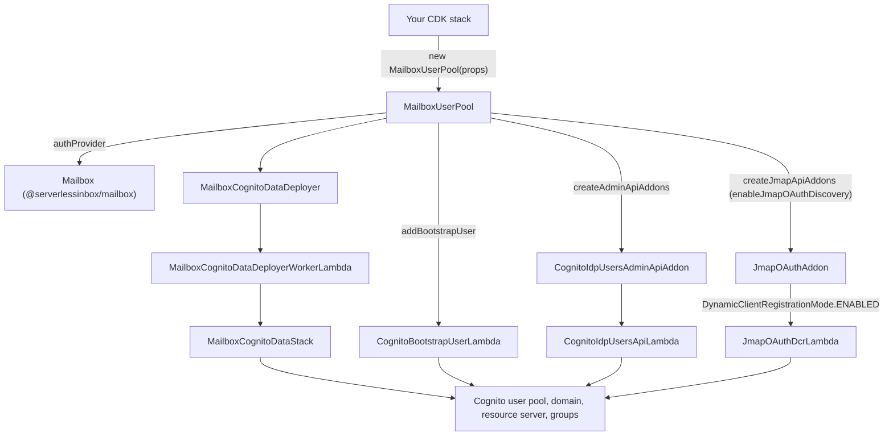

# @serverlessinbox/mailbox-cognito

> **Beta.** Use at your own risk; no warranty. Breaking changes are possible before 1.0.

Amazon Cognito as the authentication provider of a [`@serverlessinbox/mailbox`](../mailbox/) email
server. `MailboxUserPool` creates the user pool and its OAuth endpoint, issues one OAuth client per
application that calls the Admin API or the JMAP API, and contributes the Admin API addon that manages
the pool's users. It is a jsii library.

Built for [ServerlessInbox](https://github.com/serverlessinbox/mailbox-cdk).

## Concepts

- **`MailboxUserPool`** implements the auth provider contract of `@serverlessinbox/mailbox`. You pass it
  to `Mailbox` as `authProvider`; the Mailbox then trusts the tokens this pool issues.
- **Groups and roles.** Members of the admin groups (`admin` by default) may call the Admin API; members of
  the user groups (`user` by default) are mailbox users. Both lists are set through
  `MailboxUserPoolProps.authorization`.
- **OAuth clients.** The Mailbox asks the pool for the clients its UIs need. For your own applications,
  `provisionHeadlessClient` creates a client-credentials client for a machine caller, scoped to the APIs
  and permissions you list.
- **Domain.** The OAuth endpoint is served from a Cognito domain prefix you choose (`cognito`), a prefix
  derived from your hosted zone (`cognito-auto`), or your own domain with an ACM certificate (`custom`).
- **Sign-in policy.** `MfaMode` sets whether a second factor (TOTP) is off, optional or required for the
  whole pool; `passwordMinLength` sets the password policy.
- **JMAP OAuth discovery and dynamic client registration.** With `enableJmapOAuthDiscovery` the JMAP API
  publishes an OIDC discovery document; `DynamicClientRegistrationMode` additionally lets clients register
  themselves.
- **Retained pool.** The pool lives in its own sub-stack, so deleting the construct from your stack leaves
  the pool and its users in place.

## Solution design



`MailboxUserPool` is the single entry point. It deploys the pool through the data deployer, a Step
Functions-backed custom resource that creates the `MailboxCognitoDataStack` in the same region as your
stack. The Admin API addon, the JMAP OAuth addon and the bootstrap user are built on top of the pool the
deployer returns.

Folders of `src/`:

| Folder | Holds |
|---|---|
| `src/user-pool/` | `MailboxUserPool`, its props, enums and the Cognito scope map |
| `src/data-stack/` | The sub-stack that owns the user pool, and the deployer that creates it |
| `src/resources/lambdas/` | One wrapper class per Lambda, with its environment and grants |
| `src/runtime/` | Code that runs inside the bootstrap-user, user-management API and OAuth registration Lambdas, one folder per Lambda |
| `src/utils/` | Helpers shared by the Lambdas, such as the generator of temporary passwords |
| `src/__tests__/` | Tests. Not published. |

## Where to find things

| Question | Where to look |
|---|---|
| Which Lambdas exist, and what may each do? | `src/resources/lambdas/`: one file per Lambda with its environment variables and grants |
| Where is a Lambda's handler code? | `src/runtime/`, one folder per Lambda |
| Where is the user pool itself defined? | `src/data-stack/mailbox-cognito-data-stack.ts` |
| Where are the OAuth clients, groups and scopes decided? | `src/user-pool/mailbox-user-pool.ts` and `src/user-pool/cognito-scopemap.ts` |
| Where is the user management API added to the Admin API? | `src/cognito-idp-users-addon.ts` |
| Where is OAuth discovery and client registration added to the JMAP API? | `src/jmap-oauth-addon.ts` |

## Usage

```sh
npm install @serverlessinbox/mailbox @serverlessinbox/mailbox-cognito
```

A user pool whose OAuth domain is derived from the hosted zone of your Mailbox:

```typescript
import { Stack, StackProps } from 'aws-cdk-lib';
import { Construct } from 'constructs';
import { HostedZoneLookup, Mailbox } from '@serverlessinbox/mailbox';
import { MailboxUserPool } from '@serverlessinbox/mailbox-cognito';

export class MyMailboxStack extends Stack {
  constructor(scope: Construct, id: string, props?: StackProps) {
    super(scope, id, props);

    const zone = new HostedZoneLookup(this, 'Zone', {
      hostedZoneId: 'Z0123456789ABCDEFGHIJ',
    });

    const authProvider = new MailboxUserPool(this, 'UserPool', {
      domain: { kind: 'cognito-auto', hostedZone: zone.hostedZone },
    });

    new Mailbox(this, 'Mailbox', {
      hostedZone: zone.hostedZone,
      authProvider,
    });
  }
}
```

A pool with required MFA, OAuth discovery with dynamic client registration, a first administrator and a
machine client that may call the JMAP API:

```typescript
import { CfnOutput, Stack, StackProps } from 'aws-cdk-lib';
import { Construct } from 'constructs';
import { Mailbox, Permission } from '@serverlessinbox/mailbox';
import {
  DynamicClientRegistrationMode,
  MailboxUserPool,
  MfaMode,
  UserPoolAudience,
} from '@serverlessinbox/mailbox-cognito';

export class MySecuredMailboxStack extends Stack {
  constructor(scope: Construct, id: string, props?: StackProps) {
    super(scope, id, props);

    const authProvider = new MailboxUserPool(this, 'UserPool', {
      domain: { kind: 'cognito', cognitoDomainPrefix: 'my-mailbox' },
      mfaMode: MfaMode.ON,
      enableJmapOAuthDiscovery: true,
      dynamicClientRegistration: DynamicClientRegistrationMode.ENABLED,
    });

    const admin = authProvider.addBootstrapUser({ username: 'admin', groups: ['admin'] });
    new CfnOutput(this, 'AdminTemporaryPassword', { value: admin.temporaryPassword });

    const importer = authProvider.provisionHeadlessClient({
      name: 'importer',
      audiences: [UserPoolAudience.JMAP_API],
      permissions: [Permission.MAIL_READ, Permission.MAIL_WRITE],
    });

    new Mailbox(this, 'Mailbox', { authProvider });
    new CfnOutput(this, 'ImporterClientId', { value: importer.clientId });
  }
}
```

## Reference

| Export | Purpose |
|---|---|
| `MailboxUserPool`, `MailboxUserPoolProps` | The construct and its settings |
| `MailboxUserPoolDomainConfig`, `MailboxUserPoolCognitoDomain`, `MailboxUserPoolCognitoAutoDomain`, `MailboxUserPoolCustomDomain` | Where the OAuth endpoint is served from |
| `MailboxUserPoolAuthorizationConfig` | The Cognito groups that mark administrators and regular users |
| `ProvisionHeadlessClientConfig`, `UserPoolAudience` | A machine client and the APIs it may call |
| `BootstrapUserConfig`, `IBootstrapUserHandle` | The first user to create, and the handle that exposes its generated temporary password |
| `MfaMode` | Whether a second factor is off, optional or required |
| `DynamicClientRegistrationMode` | Whether OAuth clients may register themselves |
| `MailboxUserPoolAdminUiConfig`, `MailboxUserPoolIdpUiConfig` | What the pool tells the Admin UI about its identity provider |
| `ICognitoIdpUsersPoolConfig` | The user pool settings the user-management addon reads |
| `COGNITO_ARTIFACT_PACKAGE` | Name of the artifact package the pool's Lambdas are resolved from |

## Building and testing

```sh
yarn install
yarn test
```

`yarn prepare-manifest build` runs the jsii build that produces the published package.
