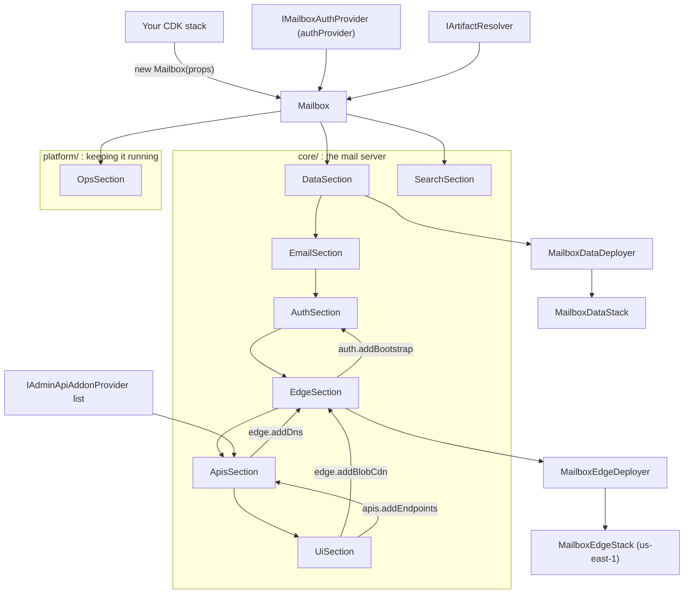

# @serverlessinbox/mailbox

The CDK construct that deploys a complete serverless JMAP email server into your AWS account: mail
receiving and sending, the data stores, the Admin and JMAP APIs, WebSocket push, the Admin and Webmail
UIs, the CDN, DNS and the operational pieces around them. It is a jsii library, so it is usable from
TypeScript, and from the other jsii target languages.

Built for [ServerlessInbox](https://github.com/serverlessinbox/mailbox-cdk).

## Concepts

- **`Mailbox`** is the whole server as one construct. You add it to your own stack and give it an
  `authProvider`; everything else has a default.
- **The auth provider** supplies sign-in: the token issuer, its endpoints, the authorization policies and
  the OAuth clients. The Mailbox is provider-neutral and trusts whatever implements `IMailboxAuthProvider`.
  [`@serverlessinbox/mailbox-cognito`](../mailbox-cognito/) is the Cognito implementation.
- **Admin API addons** are optional capabilities of the Admin API. You opt in by listing an
  `IAdminApiAddonProvider` in `MailboxProps.adminApiAddonProviders`; nothing is enabled by being installed.
  `StackUpdateAddonProvider` and `SupportAddonProvider` are such providers.
- **The artifact resolver** locates the prebuilt Lambda code and UI bundles that the Mailbox deploys. By
  default it is pinned to the artifact versions that ship with the package. Pass an `AutoUpdater` as
  `MailboxProps.artifactResolver` to keep a deployed Mailbox on newer releases.
- **Hosted zone and certificates.** Give the Mailbox a Route53 hosted zone and it creates the DNS records
  and ACM certificates for its endpoints. Without a zone you supply your own certificates through
  `MailboxProps.overrides` and manage DNS yourself. `HostedZoneLookup` looks the zone up once for the whole
  app.
- **Encryption.** Data at rest uses AWS-managed keys by default; `MailboxProps.kms` selects
  customer-managed keys or takes resources out of KMS.

## Solution design

The constructor builds the Mailbox as an ordered list of sections. Each section is a construct that owns
its resources and takes the sections before it as inputs. A section whose inputs exist only later (the CDN
after the UIs, the DNS records after the API endpoints) exposes an `add*` step that `Mailbox` calls once
those inputs exist.



The retained data (DynamoDB tables and the email bucket) lives in its own sub-stack, deployed by
`MailboxDataDeployer`, so deleting the Mailbox from your stack leaves the data stack, and your mail, in place. The CloudFront edge resources
live in a sub-stack deployed to us-east-1 by `MailboxEdgeDeployer`.

The code is organised in four top-level folders of `src/`:

| Folder | Holds |
|---|---|
| `src/resources/` | The resources that hold data or trigger code, one folder per kind: `lambdas`, `tables`, `queues`, `buckets`, `topics`, `events`, `workflows`. One class per resource, each owning its grants. |
| `src/core/` | How the mail server is built: the sections above, as compound constructs. |
| `src/platform/` | How the server updates and supports itself: updates, support access, operations. `core/` never imports from `platform/`. |
| `src/runtime/` | Code that runs inside the TypeScript Lambdas, one folder per Lambda. Excluded from the published API. |

## Where to find things

| Question | Where to look |
|---|---|
| Which Lambdas exist, and what may each do? | `src/resources/lambdas/`: one file per Lambda with its environment variables, its grants and the events that trigger it |
| Where is a Lambda's handler code? | TypeScript Lambdas: `src/runtime/`, one folder per Lambda. The Go Lambdas ship as prebuilt artifacts |
| Which tables, queues, buckets and topics exist? | `src/resources/tables/`, `src/resources/queues/`, `src/resources/buckets/`, `src/resources/topics/` |
| Which state machines exist? | `src/resources/workflows/` |
| What triggers what? | `src/resources/events/`: one class per schedule or event, each naming the Lambda it triggers |
| Where is a product feature assembled? | `src/core/<section>/<section>-section.ts`; `src/mailbox.ts` shows the order |
| Where are the API domains, DNS records, distributions and certificates? | `src/core/apis/`, `src/core/domains/`, `src/core/ui/`, `src/core/edge/` |
| Which resources can never be replaced? | `src/__tests__/mailbox.fixed-identity.test.ts` |

| Feature | Assembled in |
|---|---|
| Receiving, sending, delivery feedback | `src/core/email/` |
| Sign-in, API keys, first-run bootstrap | `src/core/auth/` |
| JMAP, admin, MCP, WebSocket and OAuth APIs | `src/core/apis/` |
| Mail data, data stack, deployer, audit | `src/core/data/` |
| Admin UI, webmail UI | `src/core/ui/` |
| Search index | `src/core/search/` |
| Certificates, edge function, blob CDN, DNS records | `src/core/edge/` |
| Domains | `src/core/domains/` |
| Self-update | `src/platform/update/` |
| Support access | `src/platform/support/` |
| Licence refresh, failure detection, cleanup | `src/platform/ops/` |

## Usage

```sh
npm install @serverlessinbox/mailbox @serverlessinbox/mailbox-cognito
```

A Mailbox on your domain, with Cognito as the auth provider. The hosted zone is looked up once and shared
by the Mailbox and the user pool:

```typescript
import { Stack, StackProps } from 'aws-cdk-lib';
import { Construct } from 'constructs';
import { HostedZoneLookup, Mailbox } from '@serverlessinbox/mailbox';
import { MailboxUserPool } from '@serverlessinbox/mailbox-cognito';

export class MyMailboxStack extends Stack {
  constructor(scope: Construct, id: string, props?: StackProps) {
    super(scope, id, props);

    const zone = new HostedZoneLookup(this, 'Zone', {
      hostedZoneId: 'Z0123456789ABCDEFGHIJ',
    });

    const authProvider = new MailboxUserPool(this, 'UserPool', {
      domain: { kind: 'cognito-auto', hostedZone: zone.hostedZone },
    });

    new Mailbox(this, 'Mailbox', {
      hostedZone: zone.hostedZone,
      authProvider,
    });
  }
}
```

Optional capabilities are opted into through the props: Admin API addons, the artifact resolver,
customer-managed encryption keys and your own extra CORS origins.

```typescript
import { Duration, Stack, StackProps } from 'aws-cdk-lib';
import * as kms from 'aws-cdk-lib/aws-kms';
import { Construct } from 'constructs';
import {
  AutoUpdater,
  Granularity,
  HostedZoneLookup,
  Mailbox,
  MailboxKmsMode,
  SupportAddonProvider,
  SupportMode,
} from '@serverlessinbox/mailbox';
import { MailboxUserPool } from '@serverlessinbox/mailbox-cognito';

export class MyManagedMailboxStack extends Stack {
  constructor(scope: Construct, id: string, props?: StackProps) {
    super(scope, id, props);

    const zone = new HostedZoneLookup(this, 'Zone', {
      hostedZoneId: 'Z0123456789ABCDEFGHIJ',
    });
    const authProvider = new MailboxUserPool(this, 'UserPool', {
      domain: { kind: 'cognito-auto', hostedZone: zone.hostedZone },
    });
    const updater = new AutoUpdater(this, 'Updater', {
      granularity: Granularity.MINOR,
      updateInterval: Duration.hours(12),
    });

    new Mailbox(this, 'Mailbox', {
      hostedZone: zone.hostedZone,
      authProvider,
      artifactResolver: updater,
      adminApiAddonProviders: [updater, new SupportAddonProvider({ mode: SupportMode.ENABLED })],
      extraAllowedOrigins: ['http://localhost:5173'],
      kms: {
        mode: MailboxKmsMode.CUSTOMER_MANAGED,
        key: new kms.Key(this, 'MailboxKey', { enableKeyRotation: true }),
      },
    });
  }
}
```

## Reference

| Export | Purpose |
|---|---|
| `Mailbox`, `MailboxProps` | The construct and its settings |
| `MailboxUrls`, `MailboxCertificates`, `MailboxOAuthClients` | What a created Mailbox exposes: its endpoint URLs, the certificates it created and the OAuth clients of its UIs |
| `MailboxOverrides`, `MailboxCertificateOverrides`, `MailboxSubdomainOverrides` | Your own certificates and subdomain labels per endpoint |
| `HostedZoneLookup`, `HostedZoneLookupProps` | Deploy-time Route53 zone lookup, shared across constructs |
| `IMailboxAuthProvider`, `IMailboxAuthProviderBase`, `MailboxAuthPolicies`, `AuthClientConfig` | The contract an auth provider implements |
| `AuthMethod`, `OAuthFlow`, `AuthPolicyName`, `OAuthClientName`, `Permission` | Auth vocabulary: how clients authenticate, the OAuth flows, policy and client names, and the JMAP permissions |
| `IAdminApiAddonProvider`, `IAdminApiAddon`, `AdminApiAddonContext` | The contract for adding capabilities to the Admin API |
| `IJmapApiAddon`, `JmapApiAddonContext` | The contract for adding capabilities to the JMAP API |
| `StackUpdateAddonProvider` | Admin API addon for human-gated CloudFormation stack updates |
| `SupportAddonProvider`, `SupportMode` | Admin API addon for support case management |
| `AutoUpdater`, `Granularity` | Artifact resolver that keeps a deployed Mailbox on newer releases within a chosen bound |
| `MailboxKmsMode`, `MailboxKmsResource`, `MailboxKmsConfig` | At-rest encryption settings |
| `SesReceivingMode` | Whether and how the Mailbox activates SES receiving |
| `SendStackFailuresMode` | Consent for reporting failed stack operations |
| `MailboxResourceDescriptions` | Aspect that adds readable names and descriptions to the resources of a stack |
| `ServerlessInboxTagKeys`, `applyServerlessInboxBaseTags`, `applyServerlessInboxComponentTag` | Tagging and correlation helpers |

## Building and testing

```sh
yarn install
yarn test
```

`yarn prepare-manifest build` runs the jsii build that produces the published package.
