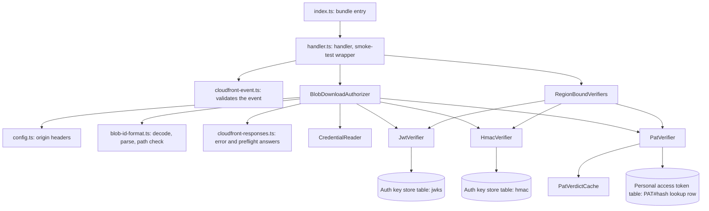
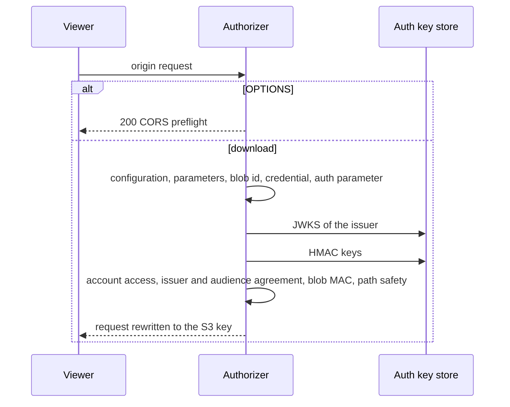

# JMAP blob download (Lambda@Edge)

An origin-request function on the CloudFront distribution in front of the blob store. It decides whether a
JMAP blob download (RFC 8620) may reach the S3 origin, and rewrites an allowed request to the blob's S3 key.
Lambda@Edge has no environment variables, so the function reads its configuration from the custom origin
headers of the S3 origin.

## Components



- `index.ts` is the bundle entry and only re-exports the handler.
- `handler.ts` reads the event, hands it to the authorizer and answers every failure as a CloudFront response.
  It flushes the buffered log only for an unexpected error.
- `BlobDownloadAuthorizer` makes the decisions and throws a `BlobRequestRejected` for each denial.
- `CredentialReader` reads the `Authorization` header as a personal access token secret, a JWT, or a refusal.
- `JwtVerifier` verifies a JWT's signature and time claims against the issuer's JWKS in the auth key store.
- `HmacVerifier` verifies the session token and the per-blob MAC against the HMAC keys in the auth key store.
- `PatVerifier` reads the lookup row of a personal access token secret, and `PatVerdictCache` holds the verdict per
  table: five minutes when usable, never past the row's expiry, and one minute when not.
- `RegionBoundVerifiers` builds the DynamoDB client and the verifiers once per region, when a request first
  names the region, so their key caches live as long as the container.

## Request

```
GET /download?accountId={accountId}&blobId={base64url blob id}&type={mime type}&name={file name}&auth={session token}
Authorization: Bearer {JWT}
Authorization: Bearer {personal access token secret}
Authorization: Basic {base64 of username:personal access token secret}
```

`accountId`, `blobId`, the `auth` session token and one credential are required. The credential is a JWT, or a
personal access token secret (starts with `sipat_`, 55 characters) as a Bearer token or as the Basic password;
the Basic username is ignored. A decoded blob id is one of:

| Form | Blob |
|---|---|
| `eml:{emailId}:{path}:{mac}` | Email part; the MAC is the segment after the last colon |
| `cnt:{cardId}:{path}` | Contact media |
| `prn:{principalId}:{path}` | Principal picture |

## Decisions



| Check | Status | Answer |
|---|---|---|
| No origin headers, or a missing or invalid `x-auth-key-store-table`, `x-region` or `x-jwt-algorithms` | 500 | Configuration error: names the header |
| `accountId` or `blobId` missing | 400 | Missing required parameters: accountId and blobId |
| Blob id not base64url, or of no known form | 400 | Invalid blobId format |
| No `Bearer` token or `Basic` credential, or a `Basic` credential whose password is not a personal access token secret | 401 | Missing or invalid Authorization header |
| A personal access token secret of the wrong length (not checked against the table) | 401 | Missing or invalid Authorization header |
| No `auth` parameter | 401 | Unauthorized |
| JWT does not verify | 401 | Unauthorized |
| Personal access token request without the `x-pat-table` header | 401 | Unauthorized (the log names the header) |
| Personal access token lookup row missing, revoked, expired, or with an unreadable expiry or tenant | 401 | Unauthorized |
| Session token does not verify | 403 | Access denied: invalid auth token |
| Personal access token session whose subject is not the token's id | 403 | Access denied: token mismatch |
| Personal access token session without the `pat` issuer and audience (a JWT login's session) | 403 | Access denied: session not issued to a token |
| Personal access token session of another tenant than the token's | 403 | Access denied: tenant mismatch |
| Email or contact blob of an account the session does not list | 403 | Access denied: account not authorized |
| Session issuer or audience differs from the JWT's | 403 | Access denied: issuer mismatch / audience mismatch |
| Email blob without a MAC, or with one that does not verify | 403 | Access denied: invalid blob |
| Path empty, `..`, or with a separator or control character | 403 | Access denied: invalid blob path |
| A malformed event, a failed personal access token lookup read, or any unexpected failure | 500 | Internal server error |

A principal blob is keyed under its tenant, not an account, so it needs no account in the session.

An allowed request gets the URI `/tenants/{tenantId}/accounts/{accountId}/{emails|contacts}/{entityId}/{path}`
(principals: `/tenants/{tenantId}/principals/{entityId}/{path}`), loses its query string, and gains
`x-content-type` and `x-content-disposition` headers from `type` and `name`.

## Personal access tokens

A personal access token secret is checked for its prefix and length, with no read for a wrong one. Its SHA-256 hex
keys the lookup row `PK = PAT#{hash}`, `SK = TOKEN` in the personal access token table; the function projects
`tenantId`, `tokenId`, `expiresAt` and `revokedAt` and nothing else. The row is usable when it names a tenant and a
token id, carries an `expiresAt` that is a time, has no `revokedAt`, and has not expired.

The verdict is read in parallel with the session token's check, and both must pass. The session token must be issued
to this token: its subject is the row's token id, its issuer and audience are `pat`, and its tenant is the row's
tenant. The requested account must be in the session, and the blob MAC and key-part checks apply as for a JWT.

Verdicts are held per container and per table: a usable one for five minutes, never past the row's expiry, and an
unusable one for one minute. A failed read is not held and is answered with a 500. Concurrent requests for one hash
share one read. The function never writes the row, so `lastUsedAt` is not updated from here.

A CDN object already cached for a token's URL is served without this function until the cache entry expires; the
distribution's maximum object lifetime is one hour.

## Configuration

Custom origin headers on the S3 origin, set by the CDN construct:

| Header | Meaning |
|---|---|
| `x-auth-key-store-table` | Name of the auth key store DynamoDB table (required) |
| `x-region` | Region of that table (required); an AWS region code such as `eu-west-1` |
| `x-jwt-algorithms` | Comma-separated JWT algorithms to accept; `RS256` when absent. Supported: RS256, RS384, RS512, ES256, ES384; any other entry is a configuration error |
| `x-pat-table` | Name of the personal access token table. Optional: without it a personal access token request is a 401 that names the header, and JWT requests are unaffected. Present but empty is a configuration error |

A missing or invalid header is answered with a 500 whose message names the header, and the same text is
written to the log.

## Smoke test

The handler is wrapped in `withSmokeTest` with no checks, because a Lambda@Edge function has no environment
to check. The artifact updater's probe proves that the new code loads and answers.
