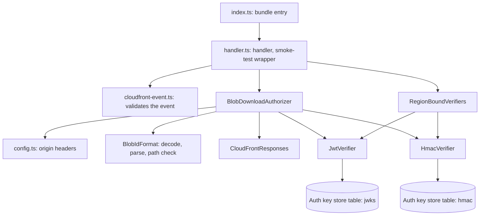
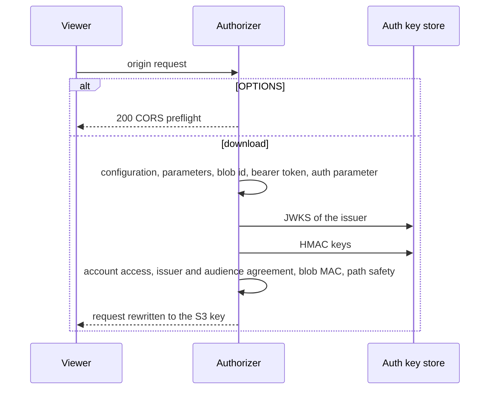

# JMAP blob download (Lambda@Edge)

An origin-request function on the CloudFront distribution in front of the blob store. It decides whether a
JMAP blob download (RFC 8620) may reach the S3 origin, and rewrites an allowed request to the blob's S3 key.
Lambda@Edge has no environment variables, so the function reads its configuration from the custom origin
headers of the S3 origin.

## Components



- `index.ts` is the bundle entry and only re-exports the handler.
- `handler.ts` reads the event, hands it to the authorizer and answers every failure as a CloudFront response.
  It flushes the buffered log only for an unexpected error.
- `BlobDownloadAuthorizer` makes the decisions and throws a `BlobRequestRejected` for each denial.
- `JwtVerifier` verifies a JWT's signature and time claims against the issuer's JWKS in the auth key store.
- `HmacVerifier` verifies the session token and the per-blob MAC against the HMAC keys in the auth key store.
- `RegionBoundVerifiers` builds the DynamoDB client and both verifiers once, in the region of the first
  request, so their key caches live as long as the container.

## Request

```
GET /download?accountId={accountId}&blobId={base64url blob id}&type={mime type}&name={file name}&auth={session token}
Authorization: Bearer {JWT}
```

`accountId`, `blobId`, the bearer JWT and the `auth` session token are required. A decoded blob id is one of:

| Form | Blob |
|---|---|
| `eml:{emailId}:{path}:{mac}` | Email part; the MAC is the segment after the last colon |
| `cnt:{cardId}:{path}` | Contact media |
| `prn:{principalId}:{path}` | Principal picture |

## Decisions



| Check | Status | Answer |
|---|---|---|
| No origin headers, or no table | 500 | Configuration error |
| `accountId` or `blobId` missing | 400 | Missing required parameters: accountId and blobId |
| Blob id not base64url, or of no known form | 400 | Invalid blobId format |
| No `Bearer` token | 401 | Missing or invalid Authorization header |
| No `auth` parameter | 401 | Unauthorized |
| JWT does not verify | 401 | Unauthorized |
| Session token does not verify | 403 | Access denied: invalid auth token |
| Email or contact blob of an account the session does not list | 403 | Access denied: account not authorized |
| Session issuer or audience differs from the JWT's | 403 | Access denied: issuer mismatch / audience mismatch |
| Email blob without a MAC, or with one that does not verify | 403 | Access denied: invalid blob |
| Path empty, `..`, or with a separator or control character | 403 | Access denied: invalid blob path |
| A malformed event, or any unexpected failure | 500 | Internal server error |

A principal blob is keyed under its tenant, not an account, so it needs no account in the session.

An allowed request gets the URI `/tenants/{tenantId}/accounts/{accountId}/{emails|contacts}/{entityId}/{path}`
(principals: `/tenants/{tenantId}/principals/{entityId}/{path}`), loses its query string, and gains
`x-content-type` and `x-content-disposition` headers from `type` and `name`.

## Configuration

Custom origin headers on the S3 origin, set by the CDN construct:

| Header | Meaning |
|---|---|
| `x-auth-key-store-table` | Name of the auth key store DynamoDB table (required) |
| `x-region` | Region of that table; `us-east-1` when absent |
| `x-jwt-algorithms` | Comma-separated JWT algorithms to accept; `RS256` when absent. Supported: RS256, RS384, RS512, ES256, ES384 |

## Smoke test

The handler is wrapped in `withSmokeTest` with no checks, because a Lambda@Edge function has no environment
to check. The artifact updater's probe proves that the new code loads and answers.
